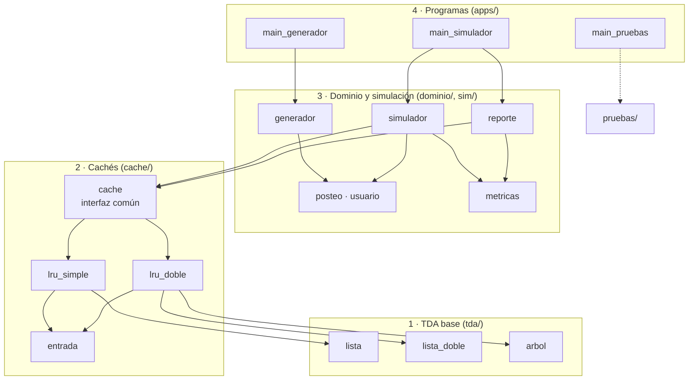
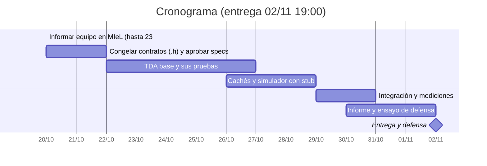

# Arquitectura y reparto — TP LRU Cache

Copia en el repo del doc compartido "TP LRU Cache — Arquitectura y reparto". Si cambia una decisión, se
actualiza acá y en el doc. Los contratos detallados de cada primitiva están en
[`primitivas.md`](primitivas.md).

## Principios

El proyecto se arma en cuatro capas con dependencias en un solo sentido: TDA base → cachés →
simulación → programas. Ningún módulo de abajo incluye un `.h` de arriba, así que cualquier
funcionalidad nueva de la defensa toca una sola capa.

- **Alta cohesión:** cada `.c` hace una sola cosa. La lista no sabe qué es una caché; la caché no sabe
  qué es un posteo; el simulador no sabe si la caché usa lista o árbol.
- **Bajo acoplamiento:** los módulos se hablan solo por las primitivas de su `.h`. Nadie toca `->sig`,
  `->ant` o `->izq` de una estructura ajena.
- **Genericidad estilo cátedra:** nodos con `void *info` + `size_t tamInfo`, copias con `memcpy`,
  comparación con puntero a función tipo `qsort`, retornos con códigos simbólicos (`EXITO`,
  `NO_ENCONTRADO`, `ERROR_MALLOC`).
- **Estilo C89 que compila en dos configuraciones** (ver `docs/constitution.md`, principio 1): la de la
  cátedra (`-Wall -Wextra -pedantic`, CodeBlocks/MinGW) y la estricta del repo, que acepta los
  comentarios `//` de la cátedra pero rechaza todo lo que no es C89. Ojo: `-std=c89` **no** sirve,
  porque da error con los comentarios `//`.
- **Un solo ejecutable de simulación:** las dos cachés conviven detrás de una interfaz común (tabla de
  punteros a función). Como no pueden compartir nombres de primitivas, se distinguen por sufijo:
  `LruS` (Parte 1, lista simple) y `LruD` (Parte 2, lista doble + árbol).
- **Contratos primero:** el día 1 se congelan todos los `.h`. Desde ahí cada integrante programa contra
  el contrato del otro, con stubs si el otro todavía no terminó.

## Mapa de módulos

Las flechas van de quien usa a quien es usado; nunca apuntan hacia arriba. `comun.h` lo incluyen todos.



El punto de desacople es `cache`: arriba nadie sabe si hay lista o árbol, abajo ningún TDA sabe que es
parte de una caché.

Estructura de carpetas (un workspace de CodeBlocks con tres proyectos: generador, simulador y pruebas,
que comparten `tda/`, `cache/`, `dominio/` y `sim/`):

```
tp-lru/
  tda/      comun.h  lista.h/.c  lista_doble.h/.c  arbol.h/.c
  cache/    entrada.h/.c  lru_simple.h/.c  lru_doble.h/.c  cache.h/.c
  dominio/  posteo.h/.c  usuario.h/.c
  sim/      generador.h/.c  metricas.h/.c  simulador.h/.c  reporte.h/.c
  pruebas/  verificar.h  pruebas_001.c  pruebas_002.c  pruebas_003.c  pruebas_004.c
  apps/     main_generador.c  main_simulador.c  main_pruebas.c
  datos/    posteos.dat  lote_concentrado.dat  lote_disperso.dat  lote_ordenado.dat
  informe/
```

`pruebas/` tiene un archivo por spec, así cada integrante escribe sus pruebas sin pisar las de otro.
`main_pruebas.c` solo llama a las cuatro funciones de entrada (ver `MEMORY.md`).

## Contratos de cada módulo

Cada fila es un par `.h`/`.c`. La columna "Usa" es la única dependencia permitida: si alguien necesita
incluir algo que no está ahí, se discute en el grupo antes de hacerlo.

### Capa 1 — Común y TDA base (`tda/`)

| Módulo | Responsabilidad | Primitivas | Usa |
| --- | --- | --- | --- |
| `comun.h` | Códigos de retorno, macro `MIN`, `typedef` del comparador `tCmp` y de la acción `tAccion` | Solo definiciones, sin `.c` | — |
| `lista` | Lista simple genérica, idiom puntero a puntero | `crearLista`, `listaVacia`, `listaLlena`, `insPrinLista`, `buscarLista` (por dato parcial), `llevarAlPrinLista` (por clave, re-enlaza sin `malloc`), `verPrimeroLista`, `sacarPorClaveLista`, `sacarUltLista`, `recorrerLista`, `vaciarLista` | `comun.h` |
| `lista_doble` | Lista doble con `pri` y `ult` (como la cola), expone el nodo como "posición" | `crearListaD`, `listaVaciaD`, `insPrinListaD` (devuelve la posición del nodo), `verInfoListaD`, `actualizarInfoListaD`, `moverAlPrinListaD`, `sacarNodoListaD`, `verUltListaD`, `sacarUltListaD`, `recorrerListaD`, `vaciarListaD` | `comun.h` |
| `arbol` | ABB genérico ordenado por `cmp` | `crearArbol`, `insArbol`, `buscarArbol` (por dato parcial), `eliminarArbol` (por clave), `alturaArbol`, `cantNodosArbol`, `recorrerInOrdenArbol`, `vaciarArbol` | `comun.h` |

### Capa 2 — Cachés (`cache/`)

| Módulo | Responsabilidad | Primitivas | Usa |
| --- | --- | --- | --- |
| `entrada` | Arma y lee el bloque `[clave][valor]` que guardan las dos cachés | `crearEntrada`, `copiarValorEntrada` | `comun.h` |
| `lru_simple` | Parte 1: LRU sobre lista simple | `crearLruS`, `agregarLruS`, `obtenerLruS`, `borrarLruS`, `vaciarLruS` | `lista`, `entrada` |
| `lru_doble` | Parte 2: LRU sobre lista doble + árbol índice | Las mismas con sufijo `LruD` + `alturaIndiceLruD` y `verificarLruD` | `lista_doble`, `arbol`, `entrada` |
| `cache` | Interfaz común: una `tCache` que envuelve cualquiera de las dos (o ninguna) | `crearCacheSimple`, `crearCacheDoble`, `crearSinCache`, `agregarCache`, `obtenerCache`, `borrarCache`, `vaciarCache`, `nombreCache`, `alturaIndiceCache` | `lru_simple`, `lru_doble` |

Firma común de las primitivas de caché: `agregar(pCache, clave, tamClave, valor, tamValor)` y
`obtener(pCache, clave, tamClave, valor, tamValor)`, que devuelve `EXITO` o `NO_ENCONTRADO` y copia
con `MIN(tamGuardado, tamValor)`. El enunciado nombra las primitivas en snake_case
(`crear_lrucache`); el docente aceptó camelCase con sufijo (`crearLruS`) siempre que todo el proyecto
use un solo estilo (ver `MEMORY.md`).

### Capa 3 — Dominio y simulación (`dominio/`, `sim/`)

| Módulo | Responsabilidad | Primitivas | Usa |
| --- | --- | --- | --- |
| `posteo` | Registro `tPosteo {int id; char texto[141];}` y los dos modos de acceso al archivo: directo con `fseek(id * sizeof)` y con seek simulado | `leerPosteoPorId`, `leerPosteoConSeek` (ambas con la firma `tLectorPosteo`), `escribirPosteo`, `cmpIdPosteo` | `comun.h` |
| `usuario` | Registro `tUsuario {char usuario[15]; int feed[20];}` | `leerUsuario`, `escribirUsuario` | `comun.h` |
| `generador` | Genera posteos y lotes con semilla; una estrategia por tipo de lote | `generarPosteos`, `generarLote`, estrategias `feedConcentrado`, `feedDisperso`, `feedOrdenado` | `posteo`, `usuario` |
| `metricas` | Contadores y tiempos de una corrida | `iniciarMetricas`, `registrarAcierto`, `registrarFallo`, `registrarLectura`, `registrarUsuario`, `registrarPosteo`, `fijarTiempo`, `promedioPorPosteo`, `promedioPorUsuario` | — |
| `simulador` | Recorre el lote y pide cada posteo a la caché o al archivo | `simular` | `cache`, `posteo`, `usuario`, `metricas` |
| `reporte` | Imprime la tabla de resultados y un CSV para el informe | `imprimirEncabezado`, `imprimirFila`, `exportarEncabezadoCsv`, `exportarCsv` | `metricas`, `cache` |

### Capa 4 — Programas (`apps/`)

1. `main_generador.c`: `generador <semilla> <usuarios> <grupo_concentrado>`; genera `posteos.dat` y los
   tres lotes.
2. `main_simulador.c`: `simulador [directo | seek | ambos]`; corre cada modo × lote × caché × capacidad
   y llama a `reporte`.
3. `main_pruebas.c`: llama a las pruebas de cada spec (`pruebas/`) y devuelve 1 si alguna falló.

## Interfaz común de caché

El simulador recibe una `tCache` y nunca sabe qué implementación hay adentro. Ese desacople es lo que
permite medir Parte 1, Parte 2 y "sin caché" con el mismo código.

### Qué guarda `tCache`

| Campo | Tipo (en palabras) | Para qué |
| --- | --- | --- |
| `impl` | `void*` a una `tLruS`, una `tLruD` o `NULL` | El estado real de la caché elegida |
| `agregar`, `obtener`, `borrar`, `vaciar`, `altura` | Punteros a función que reciben `void *impl` (`altura`, `const void *impl`) | Despacho a la implementación |
| `nombre` | Cadena fija ("Lista simple", "Lista doble + ABB", "Sin cache", sin tilde) | Lo usa `reporte` |

Los punteros a función apuntan a **adaptadores** chiquitos dentro de `cache.c`, que castean `impl` y
llaman a `agregarLruS` o `agregarLruD`. `cache.c` es el único archivo que conoce a las dos
implementaciones. Para "sin caché", `obtener` siempre devuelve `NO_ENCONTRADO` y `agregar` no hace nada:
el simulador no necesita un `if` especial. La altura del índice también va por un adaptador (`altura`):
la Parte 2 devuelve la del árbol y las otras dos, -1, sin preguntar qué variante es (27/10/2026).

### Formato de cada entrada: la clave va primero

Cada elemento de la caché se guarda como **un solo bloque** `[clave][valor]` en el `info` del nodo, con
`tamInfo = tamClave + tamValor`.

| Estructura | Contenido de `info` | Dueña de la memoria |
| --- | --- | --- |
| Lista simple (Parte 1) | `[clave][valor]` | La lista |
| Lista doble (Parte 2) | `[clave][valor]` | La lista |
| Árbol índice (Parte 2) | `[clave][posición del nodo de la lista]` | El árbol, solo de su copia de la clave y del puntero |

Como la clave está al principio del bloque, la función de comparación del usuario (`cmp`) se le puede
pasar **directo** a `buscarLista` o `buscarArbol` comparando contra la clave sola: es la búsqueda por
dato parcial de la cátedra. No hace falta un comparador intermedio ni variables globales.

Dos reglas para que esto funcione:

- El valor se lee y escribe siempre con `memcpy` desde `(char*)info + tamClave`. Nunca castear ese
  puntero a `tPosteo*`: puede no estar alineado.
- La caché recibe `tamClave` en cada llamada para saber dónde empieza el valor.

## Parte 2: consistencia y memoria

La regla de oro: **la lista es dueña de los datos, el árbol es dueño solo de su índice.** El árbol guarda
una copia de la clave y la posición del nodo de la lista, pero nunca libera ese nodo. Así cada `free`
tiene un único responsable y no hay doble liberación.

### Qué hace cada primitiva sobre cada estructura

| Primitiva | Árbol índice | Lista doble | Orden que importa |
| --- | --- | --- | --- |
| `obtenerLruD` encuentra | `buscarArbol` → posición | `moverAlPrinListaD(pos)` y copiar el valor | — |
| `obtenerLruD` no encuentra | `buscarArbol` falla | Nada | Devolver `NO_ENCONTRADO` sin tocar nada |
| `agregarLruD` clave existente | Nada: la posición no cambia | `actualizarInfoListaD(pos)` + `moverAlPrinListaD(pos)` | Si el nuevo valor no entra en memoria, la caché queda como estaba |
| `agregarLruD` clave nueva, hay lugar | `insArbol([clave][pos])` | `insPrinListaD` → posición | Lista primero (hace falta la posición); si el árbol falla, sacar el nodo recién insertado |
| `agregarLruD` clave nueva, caché llena | `eliminarArbol(clave del último)` | `sacarUltListaD` | Descartar antes de insertar, así nunca se supera la capacidad |
| `borrarLruD` | `buscarArbol` → posición, luego `eliminarArbol` | `sacarNodoListaD(pos)` | Leer la posición antes de borrar del árbol |
| `vaciarLruD` | `vaciarArbol` (libera solo infos del árbol) | `vaciarListaD` (libera nodos y datos) | Cualquiera, porque el árbol no libera nodos de la lista |

### Decisiones de diseño

- **Lista doble con `pri` y `ult`.** El apunte usa lista doble con puntero flotante; acá no sirve porque
  la caché necesita el principio y el final sin recorrer. Se modela igual que la cola dinámica.
  Alternativa válida: lista doble circular, donde el último es `pri->ant`.
- **La posición sale de la lista como `void*` opaco.** Es el único acoplamiento entre `lru_doble` y la
  implementación de la lista, y queda documentado en `lista_doble.h`. El árbol la guarda como bytes sin
  saber qué es.
- **El árbol copia la clave.** Gasta un poco más de memoria, pero cada estructura libera lo suyo.
  Compartir el puntero a la clave ahorra memoria y complica el orden de liberación.
- **`eliminarArbol` es la primitiva más difícil.** El caso de dos hijos se resuelve reemplazando por el
  menor del subárbol derecho. Hay que probarla con hoja, un hijo, dos hijos y raíz.
- **Recorrer el árbol de forma iterativa en buscar e insertar.** En el lote ordenado el árbol degenera
  en lista y su altura llega a la capacidad de la caché: una versión recursiva con capacidades grandes
  puede quedarse sin pila.

## Parte 3: generador, simulador e informe

Son dos programas separados que comparten solo los módulos `posteo` y `usuario`: el generador escribe
los `.dat`, el simulador los lee.

### Generador de lotes

- Recibe la semilla por `argv` y llama a `srand(semilla)` una sola vez: la misma semilla genera
  exactamente el mismo lote.
- Genera `posteos.dat` con 50000 registros donde `id` = posición en el archivo.
- Cada tipo de lote es una **estrategia**: una función que llena el `feed[20]` de un usuario.
  `generarLote` recibe un puntero a esa función, así agregar un lote nuevo es escribir una función y no
  tocar nada más.

| Lote | Estrategia del feed | Qué debería mostrar |
| --- | --- | --- |
| Concentrado | Ids sorteados de un grupo chico de posteos "populares" | Muchos aciertos aun con caché chica |
| Disperso | Ids sorteados en todo el rango 0 a 49999 | Casi todo fallos: la caché solo agrega costo |
| Ordenado | El pedido número j recibe el id ⌊j × 50000 / pedidos⌋: crecen parejo en todo el rango y, con 50000 usuarios, cada id se repite 20 veces seguidas | Casi todo aciertos, pero el ABB degenera en una cadena del largo de la capacidad; informar su altura |

La cantidad de usuarios (mínimo 200; propuesta 50000) y el tamaño del grupo popular se pasan por
`argv`, para generar variantes sin recompilar. El cálculo del ordenado va en `double`: `j × 50000`
desborda el `long` de 32 bits de MinGW.

### Simulador

1. Abre `posteos.dat` y el lote; recibe la `tCache` ya creada con la capacidad pedida y el lector del
   modo de acceso (`tLectorPosteo`).
2. Calentamiento: lee `posteos.dat` completo de forma secuencial y vuelve al principio, sin contar
   lecturas. Así ninguna corrida paga el disco real por haber corrido primero.
3. Toma `clock()` al inicio.
4. Por cada usuario y cada id del feed: `obtenerCache`; si falla, llama al lector (cuenta una lectura)
   y `agregarCache`.
5. Toma `clock()` al final y calcula los promedios: total / posteos y total / usuarios, en `double`.
   No mide cada posteo por separado porque cae debajo de la resolución del reloj.
6. Devuelve las métricas; `main_simulador` consulta la altura, las pasa a `reporte` y vacía la caché.

No se imprime ni se guarda ningún posteo durante la medición: imprimir dominaría el tiempo y arruinaría
la comparación.

### Matriz de corridas para el informe

Por cada modo de acceso y cada uno de los 3 lotes: una corrida sin caché (no depende de la capacidad) y
Parte 1 y Parte 2 con al menos 4 capacidades (por ejemplo 10, 100, 1000, 5000). Son 27 corridas por
modo, 54 en total. Cada fila del reporte: acceso, lote, caché, capacidad, tiempo total, por usuario, por
posteo, aciertos, fallos, lecturas y, para Parte 2, altura del árbol. El CSV ahorra pasar los números a
mano a los gráficos.

Con un millón de pedidos, la Parte 1 con capacidad 5000 en el lote disperso puede tardar decenas de
segundos por corrida: es un resultado esperado (la pregunta 2 del informe). Todo el set puede llevar
varios minutos; `simulador directo` corre solo la mitad.

### Volumen de datos y costo de acceso

Medición de referencia (Linux, sin optimizaciones, un millón de lecturas al azar). En la máquina del
informe los números van a ser otros: hay que medirlos ahí.

| Operación | Costo |
| --- | --- |
| Leer un posteo en modo directo (`fseek` al registro + `fread`) | ~630 a 940 ns |
| Leer un posteo con seek simulado (`fseek` al final + `fseek` al registro + `fread`) | ~1350 ns |
| Recorrer un nodo de lista simple | ~3,6 ns |

Lo que hay que tener en cuenta para el informe:

- **No se mide el disco físico.** El archivo de posteos (7,4 MB) queda en la memoria del sistema
  operativo después de la primera lectura. "Leer del disco" cuesta una llamada al sistema, no un
  movimiento de cabezal. Agrandar el lote no cambia eso porque el enunciado fija 50000 posteos.
- **El seek simulado encarece cada lectura** (el `fseek` extra descarta el buffer de `FILE*` y hace otra
  llamada al sistema). Solo se paga en los fallos, que es lo que la caché ahorra, y se paga igual en las
  tres variantes. Se reportan los dos modos y el informe lo declara.
- **Hacen falta muchos pedidos.** Con 200 usuarios (4000 pedidos) una corrida dura pocos milisegundos y
  `clock()` en Windows mide de a 1 ms. Con 50000 usuarios (un millón de pedidos) la corrida sin caché
  dura alrededor de un segundo. La regla: subir los usuarios hasta que la corrida sin caché en modo
  directo dure al menos 1 s en la máquina del informe.
- **Dónde deja de convenir la Parte 1 (estimación):** si un nodo cuesta unos 5 ns con el comparador,
  recorrer unos 200 elementos cuesta lo mismo que una lectura directa, y unos 300 lo mismo que una
  lectura con seek. En el lote disperso (casi todo fallos, recorrido completo), la Parte 1 debería perder
  contra "sin caché" desde capacidades de unos pocos cientos. El informe lo confirma con las corridas.

Preguntas del informe y de dónde sale cada respuesta:

- **¿Cuándo mejora la caché?** Comparar aciertos contra tiempo en concentrado y disperso.
- **¿Desde qué capacidad deja de convenir la Parte 1?** Buscar la capacidad donde la Parte 1 se vuelve
  más lenta que sin caché o que la Parte 2: el recorrido lineal crece con la capacidad, el árbol crece
  con la altura.
- **¿Qué pasa con el árbol en el lote ordenado?** Mostrar la altura informada contra la capacidad: si
  son casi iguales, el árbol es una lista y la Parte 2 pierde su ventaja.

## Reparto y cronograma

Cada integrante es dueño de una spec: un TDA base y lo que se construye encima. Así trabajan en paralelo
desde el día 2.

| Integrante | Spec | TDA base | Encima | Sección del informe |
| --- | --- | --- | --- | --- |
| Persona 1 | `001-lru-simple` | `lista` + `comun.h` + `entrada` | `lru_simple` (Parte 1) | ¿Desde qué capacidad deja de convenir la Parte 1? |
| Persona 2 | `002-lru-doble` | `lista_doble` | `lru_doble` (integra lista y árbol) | Consistencia y memoria de la Parte 2 |
| Persona 3 | `003-arbol-e-interfaz` | `arbol` | `cache` (interfaz común y adaptadores) + `main_pruebas` | ¿Qué pasa con el árbol en el lote ordenado? |
| Persona 4 | `004-simulacion` | `posteo` + `usuario` | `generador`, `metricas`, `simulador`, `reporte` | ¿Cuándo mejora la caché? + tablas y gráficos |



El 1/11 queda como colchón: código congelado, solo corrección de warnings y repaso.

Cómo se destraban entre sí:

- La Persona 2 programa `lru_doble` contra `arbol.h` antes de que el árbol exista, con un stub que busca
  linealmente.
- La Persona 4 arranca el simulador con `crearSinCache`, que no depende de ninguna caché.
- La Persona 3 escribe los adaptadores contra `lru_simple.h` y `lru_doble.h` congelados.
- Cada uno revisa el código de otro antes de integrar: en la defensa la evaluación es también individual
  y cualquiera puede tener que modificar cualquier módulo.

## Preparación para la defensa

Con esta arquitectura, casi cualquier funcionalidad pedida en vivo entra por un solo punto. La tabla
sirve para ensayar: cada integrante implementa al menos dos, en un módulo que no sea el suyo.

| Funcionalidad probable | Dónde entra | Qué no se toca |
| --- | --- | --- |
| Mostrar la caché del más reciente al menos reciente | Nueva primitiva `recorrerLru(accion)` sobre el recorrido genérico de la lista | Simulador, árbol |
| Consultar sin reordenar ("peek") | Nueva primitiva `verLru` que busca sin mover | Interfaz común, salvo que la pidan en el simulador |
| Cambiar la capacidad en caliente | `redimensionarLru`: si achica, descarta desde el final | TDA base |
| Otra política (MRU, FIFO) | Una implementación nueva más un adaptador en `cache.c` | Simulador, reporte, TDA base |
| Contador de accesos por entrada | Encabezado extra en la entrada `[clave][accesos][valor]` | Simulador |
| Mostrar el árbol índice, contar hojas o nodos por nivel | Primitiva nueva en `arbol` + una línea en `lru_doble` | Lista, simulador |
| Rebalancear el índice tras el lote ordenado | In-orden a un vector y recarga por bisección (tema del apunte) | Lista doble |
| Nuevo tipo de lote (por ejemplo 80/20) | Una estrategia nueva en `generador` | Todo lo demás |
| Otro modo de acceso a disco (por ejemplo leer también el último registro) | Una función nueva con la firma `tLectorPosteo` en `posteo` + una opción en `main_simulador` | Simulador, cachés |
| Nueva métrica (tasa de aciertos, posteo más pedido) | `metricas` + una columna en `reporte` | Cachés |
| Persistir la caché en un archivo y recargarla | Recorrer la lista y escribir `[clave][valor]` en binario | Árbol (se reconstruye al recargar) |

Antes del 02/11:

- [ ] Compila sin warnings en las dos configuraciones de la constitución, en CodeBlocks y en GCC.
- [ ] Cada uno explica con un dibujo `eliminarArbol` con dos hijos y `moverAlPrinListaD` del último nodo.
- [ ] Cada uno agregó en vivo una funcionalidad de la tabla, cronometrado, en código ajeno.
- [ ] Las cuatro specs con `validacion.md` en `VEREDICTO: APROBADO`.
- [ ] Entrega individual: cada integrante sube programa e informe a MIeL, nombrando al grupo en el mensaje.

## Orden de estudio para el parcial

1. **Lista simple con dato parcial:** `buscarLista` y `llevarAlPrinLista` con puntero a puntero.
2. **Genéricos y punteros a función:** el comparador de claves, la estrategia de lote y la tabla de la
   interfaz común son el mismo tema con tres usos.
3. **Lista doble:** primero insertar y sacar en los extremos; después sacar y mover un nodo dado.
   Dibujar los cuatro punteros que cambian antes de escribir.
4. **Recursividad:** altura, cantidad de nodos y recorridos del árbol. Caso base primero.
5. **Árbol binario de búsqueda:** insertar y buscar, después eliminar en sus tres casos.
6. **Archivos binarios:** `fseek` por posición relativa y lectura secuencial de lotes.
7. **Integración:** la caché doble obliga a razonar quién libera qué, que es lo que el corrector mira.
